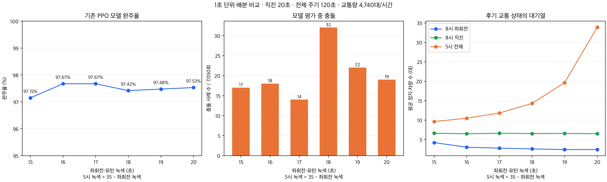

# 중앙 교차로 신호 수정과 평가 결과

팀원 포크의 `signal-grouping` (`1ab74d3`)을 기반으로 신호 순서와 시간 배분을 수정했다. 기본값은 **직진 20초·좌회전 17초·5시 18초·3시 20초·10시 20초**, 주기 120초다. 기존 PPO 평가에서 완주율 97.67%, 모델 충돌 14건을 기록했다. **배경차 검사에서도 충돌 1건이 남아 충돌 해결 완료 상태는 아니다.** 도로 구조·교통 수요·데이터 컬럼·모델 가중치는 변경하지 않았고 재학습하지 않았다.

## 변경 내용

- 마지막 세 단계를 **5시→10시→3시에서 5시→3시→10시**로 바꿨다. 5시 유턴 노랑 종료 후 10시 녹색까지의 시간을 2초에서 27초로 늘렸다.
- 직진 시간을 줄였을 때 8시 직진 대기열과 충돌이 늘어 직진은 20초로 유지했다. 좌회전과 5시 시간을 1초 단위로 비교해 17초·18초를 기본값으로 반영했다.
- 빠른 Phase 1·Phase 2·BC 평가와 관련 수집 코드가 네트워크에서 실제 신호 주기를 읽도록 수정했다. 115·120·125초 설정의 시작 시점·평가 횟수·그래프를 처리한다.
- `ParallelSumo._find_departures`가 출발 차선을 확인할 때 배경차 flow 없는 복제 도로를 사용하도록 수정했다. 원본 flow가 삽입 지점을 차지해 ego 삽입이 실패하던 문제를 해결했다. 실제 에피소드의 배경차와 차량 제어 규칙은 유지한다.

## 기본 신호

| 순서 | 초록을 받는 흐름 | 녹색 |
|---|---|---:|
| 1 | 8시·2시 직진, 기존 우회전 겹침 포함 | 20초 |
| 2 | 8시·2시 좌회전·유턴 | 17초 |
| 3 | 5시 전체 | 18초 |
| 4 | 3시 전체 | 20초 |
| 5 | 10시 전체 | 20초 |

각 단계 뒤 노랑 3초·정리 시간 2초, 전체 주기는 120초다. 5시→3시 우회전은 1·2·3단계, 8시→5시 우회전은 1·2·4단계에 초록이다. 연속 단계에 포함된 차선은 단계 사이에도 초록을 유지한다. 예전 순차 신호는 `NOHYEONG["signal_plan"]["type"] = "sequential"`로 선택한다.

## 검증 조건과 결과

SUMO 1.27.1, 0.5초 간격, 교통량 4,740대/시간으로 비교했다. 모델은 저장된 최종 PPO(`PPO_overspeed_20261124_c00`, 반복 100)이며 SHA는 [최종 집계](signal_grouping_collision_results/fine_sweep.json)에 기록했다. 교통 시드 25개(52101~52125)에서 초기·중간·후기 상태를 하나씩 생성하고, 24개 경로·94개 경로/출발 차선 조합으로 **후보별 7,050회** 평가했다. 각 사례는 새 SUMO와 사례 ID 기반 시드로 실행했으며 ego의 규칙 기반 안전 제한은 껐다.

같은 모델의 저장 설정에서 평가 메타데이터를 복원했다. 과거 다른 머신의 기록 대신 이번에 같은 조건으로 다시 실행한 결과를 비교 기준으로 사용했다. 후보 간 모델 SHA·사례 정의·신호를 제외한 도로 XML이 동일함을 확인했다.

| 설정 | 완주율 | 모델 충돌 / 7,050회 |
|---|---:|---:|
| 기존 순차 신호 125초 | 98.43% | 32 |
| 순서만 변경하고 원안의 녹색 시간을 유지한 115초 설정 | 93.18% | 51 |
| 직진 15초·좌회전 20초·5시 20초 | 97.15% | 40 |

**팀원 원안의 순서까지 그대로 유지한 설정은 별도로 PPO 평가하지 않았다.** 93.18%를 팀원 원안 그대로의 완주율로 해석하면 안 된다.

직진 20초·전체 주기 120초를 유지한 비교는 다음과 같다.

| 좌회전 / 5시 | 도착 / 7,050회 | 완주율 | 모델 충돌 | 시간 초과 | 후기 5시 평균 정지 차량 |
|---|---:|---:|---:|---:|---:|
| 15 / 20초 | 6,849 | 97.15% | 17 | 52 | 9.60대 |
| 16 / 19초 | 6,886 | 97.67% | 18 | 36 | 10.48대 |
| **17 / 18초 기본값** | **6,886** | **97.67%** | **14** | **39** | **11.80대** |
| 18 / 17초 | 6,868 | 97.42% | 32 | 47 | 14.28대 |
| 19 / 16초 | 6,872 | 97.48% | 22 | 51 | 19.64대 |
| 20 / 15초 | 6,876 | 97.53% | 19 | 53 | 33.88대 |

17초 후보는 공동 최고 완주율을 유지하면서 모델 충돌이 가장 적었다. 5시 녹색을 과하게 줄인 후보보다 대기열 누적도 작아 절충안으로 선택했다. 기존 순차 신호의 완주율 98.43%에는 아직 미치지 못한다.



순서만 변경한 115초 설정의 배경차 검사에서는 무작위 도착 10시간과 일정 간격 도착 10시간 모두 충돌이 없었다. 최종 17초 설정은 별도 무작위 도착 10시간에서 충돌 1건·텔레포트 0건을 기록했다. 16초 후보는 같은 검사에서 충돌 0건이었다. 이 배경차 검사는 PPO 모델 평가와 평가 대상·시간 단위가 다르다.

## 남은 문제

- 최종 설정의 **모델 충돌 14건은 개별 원인을 아직 재현·분류하지 않았다.** 14건은 PPO 평가 7,050회 중 충돌로 실패한 사례 수다.
- 최종 설정의 배경차 충돌 1건은 시드 9, 748.5초에 **8시→2시 차량과 2시 상류 유턴 차량의 합류 구간**에서 발생했다. 처음 고친 5시 유턴·10시 진입 충돌과는 다른 위치다.
- 중간 실험인 직진 15초·좌회전 20초의 충돌 40건은 모두 재현했다. 측면 충돌 24건 모두 차선 변경 명령 중 발생했고, 중앙 교차로 내부 충돌은 없었다. 8시 직진 후기 대기열이 평균 6.60→44.68대로 늘면서 모델의 차선 변경·제동 실패가 증가한 양상이다. 이 분석을 최종 설정의 14건에 그대로 적용할 수는 없다.
- 현재 모델·교통량·교통 시드 조건에서 선택한 결과다. 별도 새 시드·다른 교통량의 일반화 검증이나 재학습은 하지 않았다. 사고 건수가 적어 후보 간 안전 우열을 단정하지 않는다.

[검증 집계](signal_grouping_collision_results/validation_summary.json)는 순서 변경의 시드별 통계, 비교용 PPO 기준값, 중간 실험 충돌 진단을 보관한다. [최종 집계](signal_grouping_collision_results/fine_sweep.json)는 1초 단위 후보의 경로별 결과·대기열·배경차 통계를 보관한다. 중간 실험 원본과 상세 추적 로그는 로컬 `results/`에 보관하며 PR에는 포함하지 않는다.

## 재현과 테스트

같은 모델의 기존 평가 reference와 수집 메타데이터를 준비한 환경에서 새 도로·교통 상태를 생성한다. 이전 신호의 교통 스냅샷은 재사용하지 않는다.

```bash
python scripts/evaluate_fixed_routes.py prepare /tmp/signal120 \
  --reference <기존_평가_reference> --current-road --traffic-vph 4740
python scripts/evaluate_diverse_start_lanes.py prepare /tmp/signal120 /tmp/signal120-diverse
python scripts/evaluate_diverse_start_lanes.py evaluate /tmp/signal120-diverse \
  --model results/PPO_overspeed_20261124_c00/eval_runs/iter100/model.pt \
  --output /tmp/signal120-evaluation --workers 8
```

배경차 비교는 동일한 도로·수요 파일에서 `scripts/compare_signal_plans.py`의 `--plans current grouped_original grouped_10s grouped_15s grouped`를 사용한다. 위 집계의 배경차 실험은 `FLOW_SHARES` 비율과 Poisson 도착을 사용했다. `--keep`은 신호 파일·시드별 통계·충돌 XML과 `results.json`을 보존한다.

```bash
python -m pytest tests/test_signal_plan.py tests/test_parallel_sumo.py \
  tests/test_signal_experiment.py tests/test_evaluate_quick_bc.py \
  tests/test_clearance_reference_plots.py tests/test_isolated_evaluation.py -q
```

위 테스트 결과는 **59개 통과, 4개 건너뜀, 하위 테스트 10개 통과**다. 건너뛴 테스트는 로컬에 없는 과거 평가 자료를 필요로 한다.
