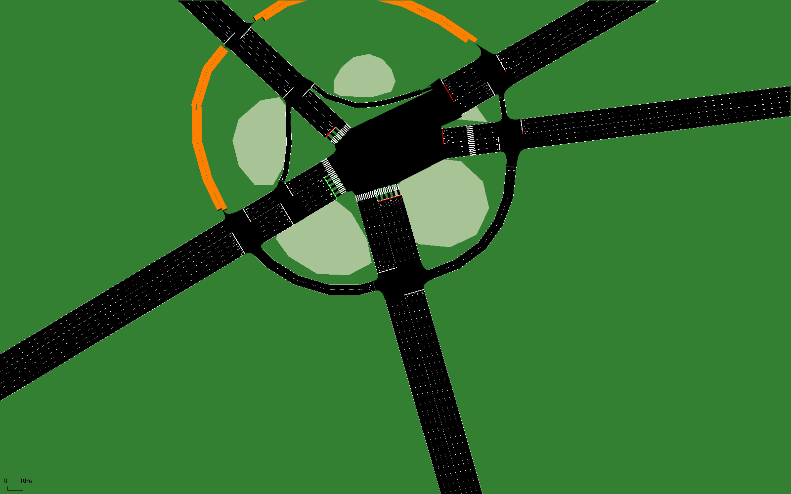
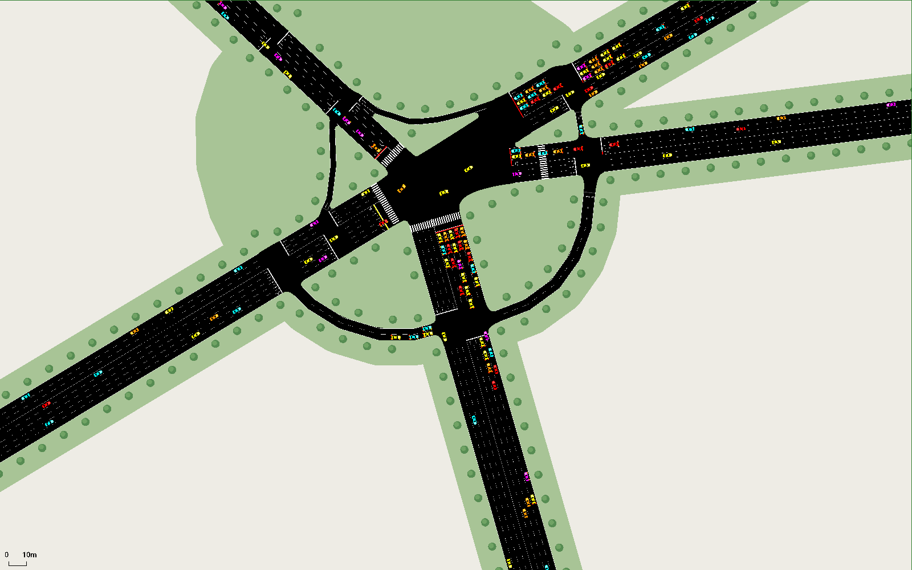
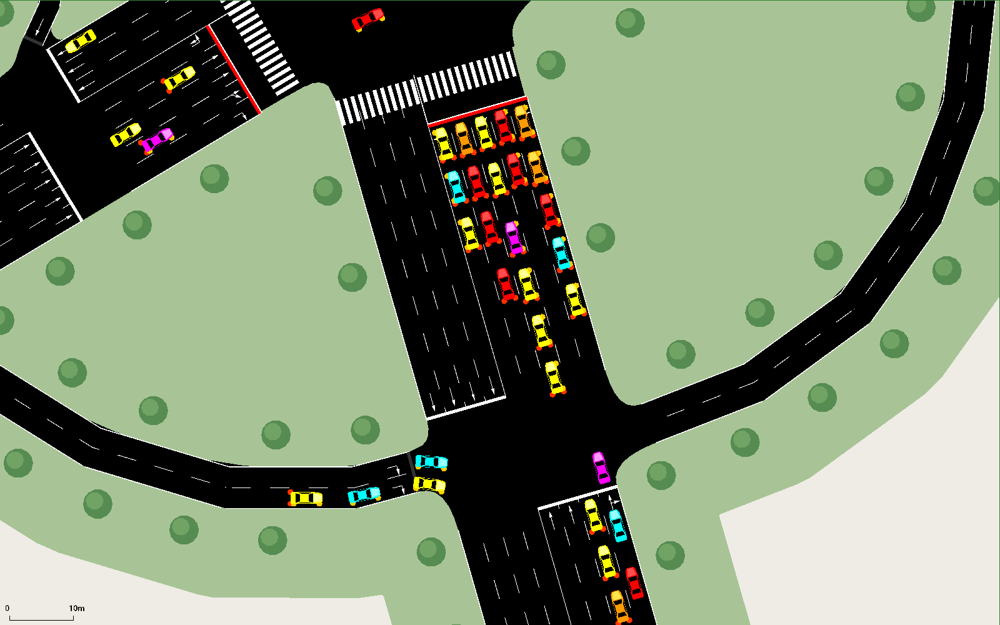
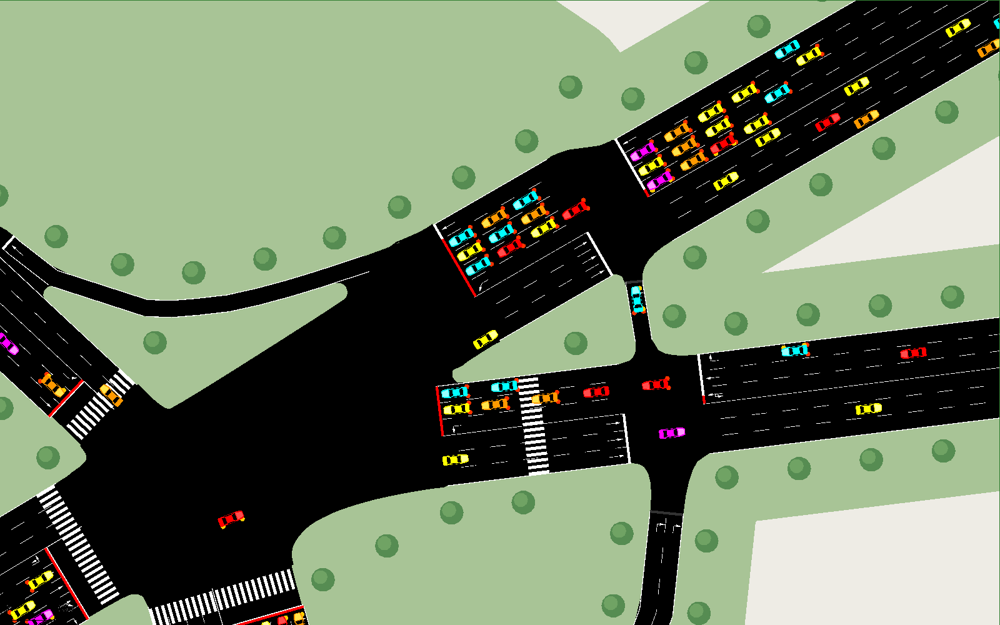

# 발표용 도로 꾸미기 (sumo-gui)

sumo-gui 화면을 지도처럼 정리한다. 배경은 단색, 도로 옆과 교차로 안쪽 빈 땅은 잔디, 길가에는 나무를 14 m 간격으로 둔다. 차가 다니지 않는 주황색 링 차선은 화면에서 지운다.

| 전 | 후 |
|---|---|
|  |  |



혼합 교통 재생 300초 시점이다. 빨간 차가 BC 차다(예전 순차 신호 때 찍은 그림이며, 꾸밈 모양은 지금도 같다).



2시 방향 진입로의 샛길 입구와 2시·3시 방향 도로 사이를 다듬은 모습이다.

## 동작 방식

- `scripts/make_road_decor.py`가 도로 파일(`highway.net.xml`)을 읽어 `highway.decor.xml`을 만든다. 이 파일은 다각형(poly)만 담은 SUMO additional 파일이다.
- 장식은 GUI로 볼 때만 불러온다. 환경이 sumo-gui를 띄울 때(`SumoHighwayEnv(gui=True)`, 예: `collect_pomdp_data.py --gui`) 보여 주는 도로에 맞춰 장식 파일을 만들고 함께 불러온다. 이미 만든 파일이 도로 파일보다 새것이면 그대로 다시 쓴다.
- 끄려면 환경 변수 `SUMO_GUI_DECOR=0`을 준다.
- 링 바깥쪽의 막힌 차선(`OUTER_N`, `OUTER_W`, `disallow="all"`)은 sumo-gui가 주황색으로 그린다. 장식 파일이 이 차선과, 이 차선 때문에 교차로에 생긴 돌출부를 잔디로 덮는다. 도로 파일의 차선은 그대로다.
- 중앙 교차로처럼 윤곽이 바늘처럼 접힌 교차로는 sumo-gui에서 구멍, 가시, 불룩한 검은 면으로 보인다(예: 2시 방향 진입로에서 샛길 `RING_A2_A4`가 갈라지는 입구, 2시와 3시 방향 도로 사이). 이런 교차로에서는 어느 차선도 지나지 않는 면을 잔디로 덮는다. 다른 교차로는 원래 모양을 그대로 둔다.
- 도로 아래에 아스팔트를 한 겹 깔아 구멍과 3 m 미만 틈(정지선과 횡단보도 사이 등)을 메운다. 차가 다니는 차선은 덮지 않는다.
- 장식 파일 생성에는 약 10초가 걸린다(0.25 m 격자). 도로 폴더마다 처음 한 번만 만든다.
- 학습과 화면 없는 평가는 `highway.sumocfg`를 그대로 쓰므로 장식을 불러오지 않는다. 도로, 차선, 정지선, 시뮬레이션 결과는 바뀌지 않는다.

## 직접 열기

최종 모델이 달리는 모습을 꾸민 화면으로 본다(장식은 자동으로 붙는다).

```bash
python collect_pomdp_data.py --model results/final/PPO/eval_runs/iter080/model.pt     --traffic-vph 4700 --episodes 1 --gui
```

도로만 따로 열 때는 장식 파일을 먼저 만든다. `<도로 폴더>`는 `highway.sumocfg`가 있는 폴더다(예: 위 명령이 만든 `data/<수집명>.sumo`).

```bash
python scripts/make_road_decor.py <도로 폴더>/highway.net.xml
sumo-gui -c <도로 폴더>/highway.sumocfg -a <도로 폴더>/highway.scenery.xml,<도로 폴더>/highway.decor.xml
```

`-a`는 설정 파일의 additional 목록을 대신하므로 기존 `highway.scenery.xml`(횡단보도, 정지선)도 함께 적는다.

색, 잔디 폭, 나무 간격은 `scripts/make_road_decor.py` 맨 위 상수에서 바꾼다.
